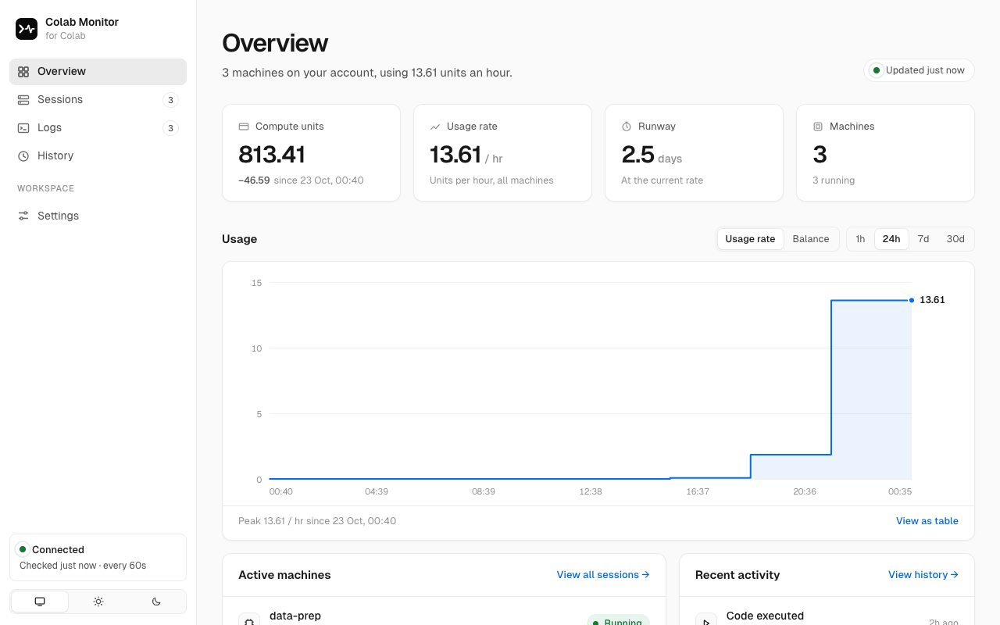

<div align="center">


# Colab Monitor

Monitor your Colab sessions, compute units, and job logs from a local dashboard or your terminal.

[](https://github.com/hohieuai/colab-monitor/actions/workflows/ci.yml)
[](LICENSE)




</div>

## What it shows

Colab Monitor reads what the [`colab` CLI](https://pypi.org/project/google-colab-cli/) records on
your computer, asks Colab for your compute units and machines, and shows both on one page.

The page has five sections:

- **Overview** shows what needs attention, your compute-unit balance, the usage rate, when the
  balance runs out at that rate, and a usage chart for the last hour up to the last 30 days. It
  also shows each job's progress, time left, and latest loss, and what you spent today and in the
  last 7 and 30 days.
- **Sessions** lists every machine on your account with its status, uptime, and estimated cost per
  hour. A status is running, idle, stopping, orphaned, or released.
- **Logs** streams the output files of your jobs and highlights errors and warnings.
- **History** shows the code, output, and errors that the CLI recorded for each session.
- **Settings** switches between light and dark mode and shows where the data comes from.

Idle and orphaned machines still use compute units, so the dashboard marks them in amber and red.
An orphaned machine runs on your account, but the CLI no longer tracks it, so nothing will stop it
for you.

Colab Monitor is read-only. It never starts, stops, or connects to a machine, and it serves the
page only to your own computer.

## Install and start

Before you start, install Python 3.12 or later and [uv](https://docs.astral.sh/uv/). Then sign in
to the `colab` CLI by running `colab sessions` once. Colab Monitor reuses that sign-in.

1. Install Colab Monitor:

   ```bash
   uv tool install git+https://github.com/hohieuai/colab-monitor
   ```

2. Create the folder that the **Logs** page reads:

   ```bash
   mkdir -p ~/colab-runs
   ```

3. Start the dashboard:

   ```bash
   colab-monitor --open
   ```

   The terminal prints `[colab-monitor] Serving http://localhost:26522/`, and your browser opens
   that address.

To stop the dashboard, press Ctrl-C in its terminal.

## Watch a job's output

To see a job on the **Logs** page, write its output to a file in `~/colab-runs`:

```bash
colab run --timeout 86400 --gpu T4 -s train train.py > ~/colab-runs/train.log 2>&1
```

Set `--timeout` longer than the job, as `86400` (one day) does here. The CLI then waits for the
job quietly, while the **Logs** page streams its output.

The file appears on the **Logs** page within three seconds, and new lines stream in while the job
runs. The page shows files that end in `.log`, `.out`, or `.err`. To read a different folder, start
Colab Monitor with `--log-dir`.

## Check from the terminal

`colab-monitor status` prints the same numbers as the dashboard and exits:

```text
$ colab-monitor status
Compute units  814.54
Usage          13.61/h
Runway         2.5 days  until Mon 14:38
Spent          37.43 today · 45.46 in 7 days · 45.46 in 30 days

MACHINE          STATUS   HARDWARE       UPTIME  IDLE      RATE  JOB
data-prep        running  CPU            9 h     -      ≈0.08/h  run(tokenize.py)
eval-sweep       running  T4             6 h     -      ≈1.76/h  run(eval.py)
llama3-finetune  running  A100 High-RAM  3 h     -     ≈11.77/h  run(train.py)

JOBS
data-prep.log        62%  ETA 5 min  · on data-prep, updated just now
eval-sweep.log       accuracy 0.871  f1 0.864  · on eval-sweep, updated just now
llama3-finetune.log  50%  ETA 4 min  3.1 it/s  loss 0.6498  lr 0.0002  val_loss 0.6098  · on llama3-finetune, updated just now

Runs: 3 ok, 0 failed in 24 h; 3 ok, 0 failed in 7 days
Machine hours (7 days): A100 3.0, CPU 9.0, T4 6.0

Nothing needs attention.
```

A `≈` marks an estimate. Colab reports one rate for the whole account, and Colab Monitor splits it
by machine. `colab-monitor watch` keeps the summary on screen and redraws it every 5 seconds.

For scripts and agents, `colab-monitor status --json` prints the same report as JSON, and
`--exit-code` exits with status 3 when something needs attention. `status` and `watch` read a
running dashboard when there is one, and otherwise read the files and check Colab themselves.

## Use it with an AI agent

Colab Monitor ships an [agent skill](skills/colab-monitor/SKILL.md). With the skill installed, ask
your coding agent to "set up Colab Monitor". The agent installs and starts the dashboard and opens
`http://localhost:26522` for you. When it runs Colab jobs for you, it writes their output where the
**Logs** page shows it, and it runs `colab-monitor status` to report progress and to check for idle
machines before it finishes.

To install the skill for Claude Code, run:

```bash
mkdir -p ~/.claude/skills/colab-monitor
curl -fsSL https://raw.githubusercontent.com/hohieuai/colab-monitor/main/skills/colab-monitor/SKILL.md \
  -o ~/.claude/skills/colab-monitor/SKILL.md
```

For another agent, copy `skills/colab-monitor/SKILL.md` into that agent's skills folder.

## Documentation

- The [command-line reference](docs/command-line.md) lists every command and option, the exit
  codes, the `status --json` fields, the files that Colab Monitor reads and writes, and its HTTP API.
- [How Colab Monitor works](docs/how-it-works.md) explains each status, how spend, cost, and job
  progress are worked out, how the dashboard limits its requests to Colab, and how it protects your
  data.
- [Troubleshooting](docs/troubleshooting.md) covers sign-in errors, port conflicts, missing logs,
  missing progress, estimated rates, and orphaned machines.
- The [security policy](SECURITY.md) explains how to report a vulnerability.
- The [contributing guide](CONTRIBUTING.md) explains how to set up a development copy, run the
  tests, and open a pull request.

## License

Copyright 2026 The Colab Monitor Authors, listed in [AUTHORS](AUTHORS). Colab Monitor is licensed
under the [Apache License 2.0](LICENSE). See [NOTICE](NOTICE) for attributions. The bundled Geist
fonts use the [SIL Open Font License](src/colab_monitor/static/fonts/OFL.txt).

Colab Monitor is an unofficial community project and is not affiliated with Colab.
